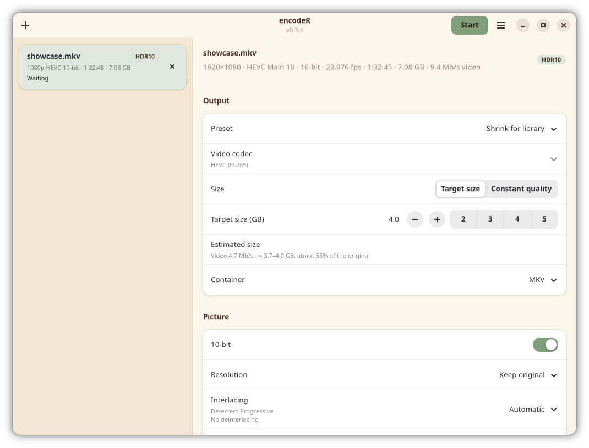

# encodeR

A small GNOME app (Rust, GTK 4, libadwaita) that turns big video files, typically 10–20 GB 4K/1080p MKVs, into 2–5 GB library copies. It encodes on the GPU through VA-API (developed on AMD RDNA4, see [Hardware support](#hardware-support)), and the output is tuned to **direct-play on an Apple TV 4K** streaming from a NAS through Plex.

App ID: `no.oyzmo.EncodeR` · Version: see `Cargo.toml` (shown in the header bar).



## Hardware support

encodeR runs on **Linux only**: it's built on VA-API and GTK 4/libadwaita, and targets Fedora with GNOME on Wayland. It isn't tied to RDNA4. At startup it test-encodes each codec on your GPU and turns off whatever the driver can't do, explaining why.

| GPU | H.264 | HEVC (incl. 10-bit) | AV1 |
| --- | --- | --- | --- |
| AMD RDNA4 (RX 9000), tested on an RX 9070 | ✅ | ✅ | ✅ |
| AMD RDNA3 (RX 7000) | ✅ | ✅ | ✅ |
| AMD Polaris, Vega, RDNA1–2 | ✅ | ✅ | ❌ |
| Intel, 6th gen and newer (iHD driver) | ✅ | ✅ | Arc and newer |
| NVIDIA | ❌ | ❌ | ❌ |

- **AMD** needs the Mesa `radeonsi` VA-API driver with the patent-encumbered codecs enabled. On Fedora that's `mesa-va-drivers-freeworld` from RPM Fusion.
- **NVIDIA** doesn't work: its VA-API driver (`nvidia-vaapi-driver`) only decodes. Supporting it would take NVENC, which encodeR doesn't use.
- Only the RX 9070 has actually been tested. The other rows are what the drivers advertise. The defaults are tuned for AMD, and the render device can be changed in settings.
- ffmpeg must include the VA-API encoders (`h264_vaapi`, `hevc_vaapi`, `av1_vaapi`). The RPM Fusion build has them, and Fedora's `ffmpeg-free` doesn't.

## The common path

Drop files on the window, check the auto-picked audio and subtitle tracks, pick a target size (2/3/4/5 GB quick picks), then press **Start**. The default preset, **Shrink for library**, is HEVC 10-bit in MKV with target-size VBR. "Apple TV compatible audio only" is on.

## What it does

Click a point for the details.

<details>
<summary><b>Tracks:</b> Picks the main audio track and the full and forced subtitles in each of your preferred languages.</summary>

Tracks are grouped by language and ranked: commentary and audio description go last, then default flag, channels, codec quality, bitrate and stream order. The top track of each preferred language is selected. SRT is preferred over PGS. If a language only has PGS subtitles, the app asks you (Keep/Drop, with "Remember for this session"). Subtitles are never burned in.

</details>

<details>
<summary><b>External subtitles:</b> Finds SRT files (and subtitle zips) for the video and syncs them to it automatically.</summary>

SRT files next to the video (`Movie.no.srt`, `Movie.en.forced.srt`, `Movie.en.sdh.srt`) are picked up automatically; more can be dropped on the window or added per job, also as the `.zip` files subtitle sites hand out. Language and kind come from the file name and can be changed. Old Windows-1252 files are converted to UTF-8. With [alass](https://github.com/kaegi/alass) (bundled in the Flatpak; elsewhere the *Install alass* button under Checks downloads the official build into `~/.local/share/encoder/bin`, or use `cargo install alass-cli`), each file is synced to the video first: against an embedded text subtitle when there is one, otherwise against the speech in the main audio track. That fixes constant offsets, 25 vs 23.976 fps timing and cuts. There's also a manual offset. An external SRT replaces an embedded PGS track of the same language and kind.

</details>

<details>
<summary><b>Fix tracks only (no re-encode):</b> Adds synced subtitles and fixes audio timing without re-encoding anything.</summary>

*Add Subtitles to Videos…* in the menu, or the *Job* row of any job. Adds synced subtitles and shifts out-of-sync audio, copying every stream as it is. The *Result* row picks where it goes: *Write a new file* (output folder, usual suffix), *Replace the original file* (a copy is written next to it and replaces it only after its tracks and duration check out), or *Subtitles next to the video* under Plex's naming (an existing sidecar that gets synced keeps its original as `.srt.orig`; the video isn't touched, so audio delays need one of the other two). Same from the terminal: `encoder --add-subs VIDEO [SRT|ZIP…] [--embed] [--no-sync]`.

</details>

<details>
<summary><b>Lip-sync:</b> Delays individual audio tracks to fix out-of-sync sources, without re-encoding them.</summary>

If the source itself is out of sync, each audio track can get a delay (clock button in the track picker). It uses the same sign as mpv and VLC: find the value while watching, then type it in. The track is read from a second, time-shifted copy of the input (`-itsoffset`), so copied tracks stay copies and Atmos is kept. A delay that stays the same through the film is covered; drift that grows over the film (a 25 vs 23.976 fps mismatch) isn't. To only fix the timing, use *Fix tracks only*: its *Audio Timing* group lists every track. A normal job that would re-encode the video just for a delay says so, with a one-click *Copy (remux only)*.

</details>

<details>
<summary><b>Apple TV audio:</b> Converts audio the Apple TV can't play (TrueHD, DTS, Opus) and copies the rest untouched.</summary>

TrueHD, DTS and Opus tracks are converted (by default to E-AC-3 5.1 at 640 kb/s, or AAC 7.1 or FLAC 7.1). Compatible tracks are copied, so E-AC-3 Atmos stays Atmos. Each converted track shows exactly what is lost.

</details>

<details>
<summary><b>Size:</b> Hits a target size in GB, or estimates the size of a constant-quality encode from sample encodes.</summary>

Target-size VBR aims 3% under the target. Constant quality (CQP/QVBR) gets a size estimate from three sample encodes at 20/50/80% into the file. When a job finishes, it reports the actual size against the target.

</details>

<details>
<summary><b>Checks:</b> Warns about settings that don't suit the source, most with a one-click fix.</summary>

8→10-bit, HDR→8-bit, HDR→H.264, same codec at a similar bitrate, output not smaller, low-bitrate source, older codec, bitrate too low (with a downscale or bigger-target suggestion), audio share above 25%, MP4 conflicts, Apple TV compatibility, software decode, Dolby Vision and HDR10+. Most checks come with a one-click fix.

</details>

<details>
<summary><b>HDR10:</b> Keeps HDR10 and checks after each encode that the metadata survived.</summary>

Colour tags are passed through. After each encode the output is probed to check that mastering-display and MaxCLL metadata survived. If they didn't and the output is MKV, they are written into the MKV header with `mkvpropedit` when mkvtoolnix is installed.

</details>

<details>
<summary><b>Dolby Vision (experimental):</b> Keeps Dolby Vision when dovi_tool is installed, and warns that it's removed when it isn't.</summary>

With `dovi_tool` on `PATH` the pipeline is: extract the RPU (profile 7 → 8.1), encode to raw HEVC, check frame counts, inject the RPU, mux, and verify the DV profile. Without `dovi_tool`, DV is removed and the app warns you.

</details>

<details>
<summary><b>Interlacing:</b> Detects interlaced and telecined video from the picture itself and fixes it.</summary>

Detected automatically from the picture with `idet`, which runs in the same pass as black-bar detection. File tags are often wrong, so they're only used as a fallback. Progressive video is left alone, even if it's tagged interlaced. Truly interlaced video is deinterlaced to 50p/60p (25p/30p optional) with `bwdif` on the CPU. The GPU's `deinterlace_vaapi` was tested on the RX 9070 and left most frames combed, so it isn't used. Telecined NTSC film is returned to its original 23.976 frames (`fieldmatch,yadif,decimate`, on the CPU). There's a per-job override, and the VMAF reference gets the same treatment so frames line up.

</details>

<details>
<summary><b>Black bars:</b> Detects letterboxing and can crop it away.</summary>

`cropdetect` runs on 6 segments and keeps the least aggressive crop (union). Results are rounded to even sizes, and crops that save under 2% are ignored. Cropping is off by default, and there's a preview with the crop outlined.

</details>

<details>
<summary><b>VMAF (opt-in):</b> Scores the visual quality of sample encodes before you commit to a full encode.</summary>

Sample encodes are scored against the source (4K model for 2160p). The app shows the mean and the worst segment. A post-encode check can be turned on.

</details>

<details>
<summary><b>Startup check:</b> Tests what your GPU and ffmpeg can actually do and turns off whatever fails.</summary>

A test encode per codec, the 10-bit profiles, each rate-control mode, cropping on the GPU, plus libvmaf, dovi_tool, mkvpropedit and alass. Codecs that fail are disabled and say why.

</details>

## Install

There are no prebuilt downloads: you build encodeR on your own machine. One command does it:

```sh
git clone https://github.com/oyzmo/encodeR.git && cd encodeR
scripts/install.sh            # menu: 4) Install flatpak is the easiest
```

**Flatpak (recommended).** `scripts/install.sh --install-flatpak` fetches everything it needs by itself: `flatpak-builder` (from Flathub if it isn't installed), the GNOME SDK, the Rust toolchain and the ffmpeg, libvmaf and dovi_tool sources and the alass binary. It then builds and installs the app for your user. You only need `flatpak` and an internet connection. The first build compiles ffmpeg, so it takes a while and a few GB of disk; later builds are much faster.

**Native.** `scripts/install.sh --native` builds with your system's Rust and installs to `~/.local`. It uses your system ffmpeg, which on Fedora must be the RPM Fusion build (see below).

### Why you have to build it yourself

The Flatpak bundles ffmpeg, and ffmpeg contains encoders for patented codecs (HEVC, H.264, AAC). Handing out a ready-made binary with those inside means distributing patented technology, which is why Fedora ships ffmpeg without them and Flathub keeps them out of apps too. encodeR's own code contains no codecs; it only runs ffmpeg and your GPU driver. So this repository ships source code and a build recipe, and the codecs are downloaded and compiled on your machine, for your own use, the same way RPM Fusion users get them.

## Build and run

```sh
sudo dnf install gtk4-devel libadwaita-devel ffmpeg   # ffmpeg from RPM Fusion, not ffmpeg-free
cargo run --release -- [FILE…]
scripts/install.sh            # menu: install native / uninstall / make flatpak / install flatpak
scripts/install.sh --native            # ~/.local/bin + desktop entry + icon
scripts/install.sh --make-flatpak      # → flatpak/no.oyzmo.EncodeR-<version>.flatpak (not installed)
scripts/install.sh --install-flatpak   # install that bundle for this user
scripts/install.sh --uninstall         # removes the native install and the user Flatpak
scripts/bump.sh patch|minor   # version lives only in Cargo.toml
scripts/deploy-github.sh [--dry-run] [--release]   # publish a clean snapshot of main to GitHub; --release tags a source-only release
```

The Flatpak (`build-aux/flatpak/no.oyzmo.EncodeR.yml`, GNOME 50 runtime) bundles its own ffmpeg 8.1.3 with VA-API and libvmaf, plus `dovi_tool` 2.3.4. The GPU driver comes from the runtime's GL extension, so the startup check shows whether hardware encoding works inside the sandbox. It has `--filesystem=host` so outputs can be written next to the inputs. It also bundles alass (the official static build, pinned by checksum) for subtitle syncing. `mkvpropedit` isn't included, so the MKV HDR repair is unavailable there. HEVC and AV1 keep HDR10 metadata on their own, and if they ever don't, the post-encode check reports it. Run `scripts/hw-verify.sh --flatpak` to run the hardware tests through the installed Flatpak. That run (0.1.5) matched the native results for HEVC, AV1 and H.264, size estimates, HDR10 and CPU deinterlacing. It also showed the bundled ffmpeg needs `--enable-gpl` for `cropdetect`. 0.1.6 adds that, and with it the Flatpak passes every test: detection, deinterlacing and inverse telecine are all correct, and 4K encodes of the heavy H.264 test clip ran about 1.4–1.9× faster than native. Building needs network access (Flathub runtimes, ffmpeg/libvmaf sources, crates.io); `flatpak-builder` is installed from Flathub when it's missing. Installing the Flatpak removes a native install, because its desktop entry would hide the Flatpak's.

Settings, the last-used options and user presets are stored in `$XDG_CONFIG_HOME/encoder/config.json`.

Headless modes, useful for checking a machine:

```sh
encoder --print-command FILE [--preset NAME] [--out DIR]   # the exact ffmpeg argv
encoder --encode FILE [--preset NAME] [--out DIR]          # run it, report estimate vs actual, HDR check
```

## Tests

```sh
cargo test                       # unit tests (pure logic)
dev/make-media.sh                # synthetic clips: letterboxed multi-track MKV, HDR10 HEVC
cargo test -- --include-ignored  # + real-ffmpeg tests (remux, cancel, cropdetect, HDR probe, VMAF)
cargo clippy --all-targets -- -D warnings && cargo fmt --check
scripts/hw-verify.sh [SDR_CLIP] [HDR10_CLIP]   # on the machine with the AMD GPU
```

`scripts/hw-verify.sh` encodes with HEVC (target size and CQ), H.264 1080p, AV1 (CQ and target size) and checks HDR10 metadata before and after with `ffprobe -show_frames -read_intervals %+#1`. Everything goes through the app's own `--encode` path. It writes a report to `/tmp/encoder-hw.*/report.txt`. Set `DV_CLIP=…` to also test Dolby Vision when `dovi_tool` is installed.

## Verified on hardware (RX 9070, Mesa 26.2.5, ffmpeg 8.1.3, 2026-10-25)

`scripts/hw-verify.sh` with generated 4K clips:

- H.264, HEVC 10-bit and AV1 10-bit encode on the GPU with hardware decode. All four rate-control modes (CQP, VBR, CBR, QVBR) and cropping on the GPU are accepted.
- Sample-based size estimates (constant quality) landed within about 1% of the real size. Target-size VBR landed 1–2% over the target.
- HDR10 survived with both HEVC and AV1: PQ, BT.2020, mastering display and light levels.
- Interlacing: 1080i25 TV, 576i25 anamorphic DVD and 480i29.97 telecine clips were each detected correctly. CPU deinterlacing gave clean 50p and kept SAR 64:45 / DAR 16:9. Inverse telecine gave 23.976 with no repeated fields. `deinterlace_vaapi` left frames combed in every mode: bob 999/1000, motion_adaptive and default about 89%, and motion_compensated isn't supported. So deinterlacing stays on the CPU.
- Encoder frame-size limits: HEVC needs at least 384×128 and AV1 at least 320×128. The app reads these limits at startup and flags videos that are too small.

## License

encodeR is free software under the [GNU General Public License v3.0 or later](LICENSE).
